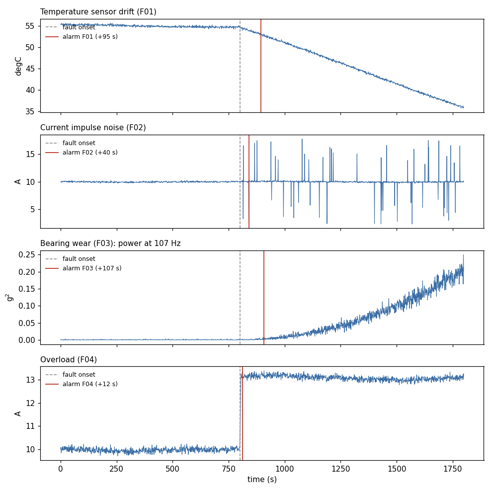

# Telemetry Fault Diagnostics

Anomaly detection and root-cause diagnosis for multi-sensor equipment telemetry, run headless from the command line.

A motor-driven pump unit reports winding **temperature**, phase **current** and **vibration** once per second. The diagnoser watches all three channels, raises an alarm when something goes wrong, and says *why*: a failing sensor, electrical noise, a worn bearing, or a real overload. A simulator with injectable faults provides ground truth, so detection latency, false alarms and classification accuracy can be measured.



## Fault codes

| Code | Fault | Channel | How it is detected |
|---|---|---|---|
| F01 | Temperature sensor drift | temperature | Residual between the measured temperature and a first-order thermal model driven by the measured current, smoothed by a scalar **Kalman filter**; alarm when the estimated bias stays above 1.5 °C for 10 s |
| F02 | Current impulse noise (EMI, loose wiring) | current | **Hampel filter** (rolling median + MAD) flags outliers; only one-sample impulses that stand out from both neighbours count, so a load step is not mistaken for noise; alarm at 3 impulses within 60 s |
| F03 | Bearing wear | vibration | **FFT** (Hann window) power in a ±6 Hz band around the outer-race defect frequency (107 Hz), standardised against the baseline, accumulated by a one-sided **CUSUM** |
| F04 | Overload | current | Median-filtered current above 115 % of the baseline for 10 s |

### Root cause, not just "anomaly"

Temperature can rise for two very different reasons, and they need different fixes:

* **Overload (F04):** current goes up and temperature follows, exactly as the thermal model predicts. The model residual stays near zero, so the temperature sensor is *not* blamed.
* **Sensor drift (F01):** temperature moves but current does not. The thermal model cannot explain the change, so the residual grows and the sensor is blamed.

The same separation keeps a sustained load step from being reported as impulse noise (F02): an impulse differs from both neighbouring samples in the same direction, a step or ramp does not.

## Results

Simulated runs of 30 minutes; the first 300 s are fault-free and used to learn each run's baseline; one fault starts at a random time between 600 and 1200 s.

**Default fault severity, 100 runs per class (500 runs), seed 0:**

| Metric | Value |
|---|---|
| Classification accuracy | 100 % (500 / 500) |
| False-positive rate (healthy runs with any alarm) | 0 % (0 / 100) |
| False alarms per healthy hour (all runs, before fault onset) | 0 |

| Fault | Median detection latency | 90th percentile |
|---|---|---|
| F01 sensor drift | 136 s | 201 s |
| F02 impulse noise | 58 s | 193 s |
| F03 bearing wear | 85 s | 112 s |
| F04 overload | 12 s | 12 s |

On 60 separate healthy runs the detectors stay well inside their limits (largest Kalman bias 0.69 °C against 1.5 °C; largest CUSUM 3.7 against 25; largest current ratio 1.02 against 1.15).

**Severity sweep.** The default faults are clearly visible, so 100 % says little about the limits. `teldiag sweep` scales every fault down to find where detection breaks (100 runs per class, seed 0; cells are *detected runs / median latency*):

| Severity | Accuracy | F01 drift | F02 impulses | F03 bearing | F04 overload |
|---|---|---|---|---|---|
| 0.10 | 43.6 % | 28/100, 700 s | 0/100 | 90/100, 540 s | 0/100 |
| 0.20 | 58.2 % | 82/100, 528 s | 9/100, 375 s | 100/100, 305 s | 0/100 |
| 0.35 | 79.8 % | 99/100, 346 s | 99/100, 100 s | 100/100, 193 s | 1/100 |
| 0.50 | 95.2 % | 100/100, 251 s | 100/100, 58 s | 100/100, 145 s | 76/100, 14 s |
| 1.00 | 100 % | 100/100, 136 s | 100/100, 58 s | 100/100, 85 s | 100/100, 12 s |

What the sweep shows:

* Weak faults are **missed or caught late, but never given the wrong root cause**: every error in the confusion matrices is a fault classified as `OK`.
* At severity ≤ 0.35 the extra load is below the 115 % rating, so not calling it an overload is the intended behaviour.
* Impulses below ~1.5 A are treated as ordinary noise, which is why F02 drops off sharply at low severity.
* Bearing wear is the most sensitive channel: the FFT band isolates the defect tone from broadband noise.

Re-create these numbers with:

```bash
teldiag evaluate --runs-per-class 100 --seed 0 --out reports/metrics.json
teldiag sweep    --runs-per-class 100 --seed 0 --out reports/sweep.json
```

## Usage

```bash
pip install ".[dev]"

# simulate one run and diagnose it
teldiag simulate --fault bearing --seed 3 --out runs/bearing.npz
teldiag diagnose runs/bearing.npz            # JSON report with fault codes and evidence

# score the diagnoser; exits 1 if accuracy or false positives regress
teldiag evaluate --runs-per-class 20 --min-accuracy 0.95 --max-fp-rate 0.0

pytest -q
```

Faults: `none`, `drift`, `spikes`, `bearing`, `overload`; `--severity` scales the fault size.

Docker (runs the accuracy / false-positive gate headless):

```bash
docker build -t teldiag .
docker run --rm teldiag
```

GitHub Actions runs the tests, the evaluation gate, the severity sweep and the Docker image on every push, and keeps the reports as build artifacts.

## Example report

```json
{
  "diagnosis": "F04",
  "alarms": [
    {
      "code": "F04",
      "name": "OVERLOAD",
      "channel": "current",
      "time_s": 812.0,
      "reason": "sustained current above rating, with temperature following the thermal model",
      "evidence": { "baseline_A": 9.953, "current_A": 13.092, "ratio": 1.315 }
    }
  ],
  "summary": { "duration_s": 1800.0, "temp_max_degC": 72.667, "current_mean_A": 11.691, "current_impulses": 0 }
}
```

## Project layout

```
teldiag/
  simulate.py   unit model (thermal model, load, vibration) and fault injection
  signals.py    Hampel filter, scalar Kalman filter, CUSUM, FFT band power, thermal prediction
  diagnose.py   detectors, fault codes, JSON report
  evaluate.py   accuracy, confusion matrix, detection latency, false alarms, severity sweep
  cli.py        simulate / diagnose / evaluate / sweep
tests/          unit tests for each signal block and end-to-end diagnosis tests
scripts/plot_example.py   draws docs/example.png (needs matplotlib)
```

## Limitations

* **The data is synthetic.** The numbers above measure the diagnoser against its own simulator. Real telemetry has effects this model leaves out (sensor quantisation, missing samples, load cycles, several faults at once), and thresholds would need re-tuning on real data.
* The thermal model's parameters (thermal resistance, time constant) are assumed known from commissioning; ambient temperature is not measured and its slow variation is absorbed by the 1.5 °C drift limit.
* One fault per run. Overlapping faults are reported as separate alarms, but the evaluation scores only the first.
* Thresholds were set by hand with healthy-run margins checked; they were not optimised.
